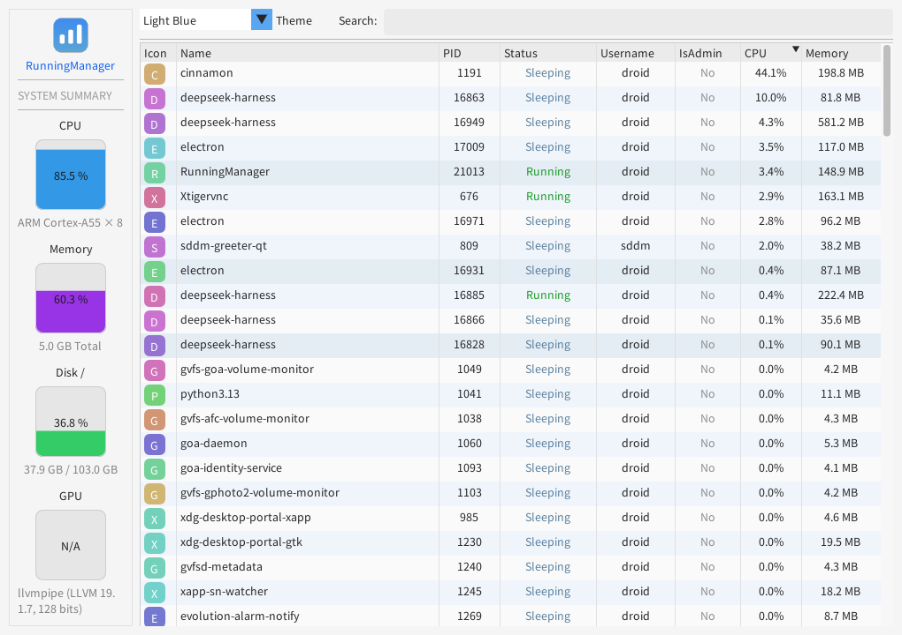

# RunningManager

**English** | [简体中文](README.zh-CN.md)

A process manager / task manager built with Dear ImGui, supporting Windows and Linux (x86_64 / arm64).



## Features

- Live process list: PID, name, status, user, elevated privileges, CPU, memory
- Sort by CPU / memory / name / PID and more, with multi-column sorting
- Search by process name, user, full path, PID, or state
- Context menu: bring window to front, open file location, kill process
- System overview: CPU, memory, disk usage, GPU
- Light blue and light pink themes
- Automatically finds Noto CJK / WenQuanYi and similar fonts to display Chinese process names correctly
- Windows: Win32 + Direct3D 11; Linux: SDL2 + OpenGL 3

> Built, run, and interactively tested on Debian GNU/Linux 13 (trixie) aarch64;
> the Windows code has been verified with a MinGW-w64 x86_64 cross-compile.

## Linux Build (Debian / Ubuntu)

Dependencies:

```bash
sudo apt install build-essential cmake pkg-config \
    libsdl2-dev libgl1-mesa-dev libx11-dev \
    fonts-noto-cjk
```

Notes:

- Requires CMake ≥ 3.16, a C++17 compiler, SDL2 (≥ 2.0.16 recommended), and OpenGL.
- `libx11-dev` provides EWMH support for "bring to front" and GUI-process detection.
  The build still works without it; bring-to-front then falls back to `xdotool`
  (if available).
- `fonts-noto-cjk` is used to display Chinese text; `fonts-wqy-microhei` and similar
  fonts also work.
- The first configure downloads Dear ImGui v1.90.1 from GitHub through CMake
  `FetchContent`, so network access is required. For offline builds, point to a local
  source tree: `-DFETCHCONTENT_SOURCE_DIR_IMGUI=/path/to/imgui`.

Build and run:

```bash
cmake -S . -B build -DCMAKE_BUILD_TYPE=Release
cmake --build build -j"$(nproc)"
./build/RunningManager
```

Install system-wide (executable only):

```bash
sudo cmake --install build --prefix /usr/local
RunningManager
```

## Debian Package (arm64)

The arm64 package built from this tree is placed in `dist/` when generated:

```bash
sudo apt install ./dist/runningmanager_1.1.0-1_arm64.deb
```

The package installs `/usr/bin/runningmanager` (with a `RunningManager`
compatibility symlink), a desktop entry, hicolor icons, and the
`runningmanager(1)` manual page.

To rebuild the package from source:

```bash
sudo apt install debhelper
dpkg-buildpackage -b -us -uc
```

The resulting `runningmanager_1.1.0-1_arm64.deb` is written to the parent
directory. The Debian build uses the vendored Dear ImGui tree in
`debian/third_party/imgui`, so package builds work offline.

## Windows Build

### Visual Studio / MSVC

Requires Visual Studio 2019/2022 with the "Desktop development with C++" workload.
From PowerShell (regular or Developer PowerShell):

```powershell
cmake -S . -B build -A x64
cmake --build build --config Release
```

`-A x64` applies to Visual Studio generators. If CMake's default generator is not
Visual Studio, specify one explicitly, for example
`-G "Visual Studio 17 2022" -A x64`. When `-G` is omitted, CMake selects the newest
installed Visual Studio generator.
The resulting `RunningManager.exe` is placed in `build/Release/`.

### MSYS2 / MinGW-w64

From the "MSYS2 MINGW64" terminal:

```bash
pacman -S --needed mingw-w64-x86_64-gcc make cmake
cmake -S . -B build -DCMAKE_BUILD_TYPE=Release
cmake --build build -j"$(nproc)"
./build/RunningManager.exe
```

Notes:

- The commands above also work directly in the MSYS2 "MSYS" terminal, as long as the
  MinGW-w64 `g++` is on `PATH`. The project detects the "MSYS CMake + MinGW-w64
  compiler" combination and switches the target platform to Windows.
- Use the default "Unix Makefiles" generator for this combination; **do not add
  `-G Ninja`** (Ninja does not translate MSYS POSIX paths, and CMake reports this
  explicitly).
- If `build/` was configured by an older version or toolchain, simply re-run the
  `cmake` command above; if it still fails, delete `build/` and retry.
- MinGW builds statically link the MinGW runtime (libstdc++/libgcc/libwinpthread), so
  the executable only depends on system DLLs and can run outside MSYS2.

## Platform Differences

| Feature | Windows | Linux |
| --- | --- | --- |
| Process enumeration | Toolhelp32 + PSAPI | `/proc` |
| CPU | `GetSystemTimes` / `GetProcessTimes` | `/proc/stat` / `/proc/<pid>/stat` |
| Memory | `GlobalMemoryStatusEx` | `/proc/meminfo` |
| Disks | `GetLogicalDriveStrings` | `/proc/self/mounts` + `statvfs` |
| GPU name | DXGI | `glGetString(GL_RENDERER)` |
| GPU usage | PDH GPU Engine counters | AMD `gpu_busy_percent` / NVIDIA `nvidia-smi`, otherwise N/A |
| Process icon | Executable icon | No system-wide icons; colored initials/CJK badge |
| Administrator | UAC elevation state | Effective UID 0 (root) |
| Kill process | `TerminateProcess` | `SIGKILL` |
| Open file location | Explorer `/select` | `xdg-open` on the containing directory |
| Bring window to front | `SetForegroundWindow` | X11 EWMH `_NET_ACTIVE_WINDOW`, falling back to `xdotool` |

Linux notes:

- Kernel threads are filtered out of the list.
- Process states are shown as Running / Sleeping / Disk Wait / Zombie / Stopped, etc.
- Without a hardware GPU (for example, with llvmpipe software rendering), the UI only
  redraws on input or once per second when data is refreshed, to reduce CPU usage.
- Window settings are stored in `~/.config/runningmanager/imgui.ini` (honoring
  `XDG_CONFIG_HOME`).
- The window is preferably centered on the second monitor and kept on top; with a
  single monitor it is centered on the primary display.

## FAQ

**`RunningManager currently supports Windows and Linux only` when configuring under MSYS2**

The `cmake` in the current terminal is not paired with a Windows-target compiler. Open
the "MSYS2 MINGW64" terminal and re-run the build commands; alternatively, stay in the
MSYS terminal and make sure `which g++` points to `/mingw64/bin/g++` (run
`export PATH=/mingw64/bin:$PATH` if needed). The project detects this combination
automatically; if it still fails, delete `build/` and retry.

**`Could NOT find SDL2` during configure**

Install `libsdl2-dev` and confirm that `pkg-config --modversion sdl2` prints a version.

**`SDL_GL_CreateContext failed` at startup**

The current session may not have a usable OpenGL context. Run `glxinfo -B` to check the
renderer; llvmpipe software rendering is usually still available without hardware
acceleration. Remote or headless environments need an X11 or Wayland session.

**Chinese process names show up as boxes**

Install any CJK font, such as `fonts-noto-cjk`, `fonts-wqy-microhei`, or
`fonts-wqy-zenhei`. The program automatically picks one from the usual font paths.

**GPU shows N/A**

Linux has no unified GPU-usage interface. The program supports AMD's
`/sys/class/drm/card*/device/gpu_busy_percent` and NVIDIA's `nvidia-smi`; other drivers
(including llvmpipe software rendering) are reported as N/A.

## Project Structure

```
src/
  main.cpp                  Windows entry point (Win32 + DX11)
  main_linux.cpp            Linux entry point (SDL2 + OpenGL3)
  ProcessManager.h          Cross-platform process data interface
  ProcessManager_win.cpp    Windows process implementation
  ProcessManager_linux.cpp  Linux /proc implementation
  SystemMonitor.h           Cross-platform system information interface
  SystemMonitor_win.cpp     Windows system information implementation
  SystemMonitor_linux.cpp   Linux system information implementation
  UIManager.cpp/.h          Shared ImGui UI
docs/
  screenshot.png            Screenshot
```

## License

See [LICENSE](LICENSE).
